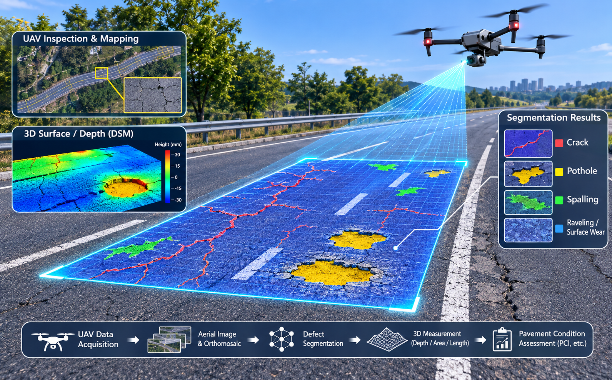
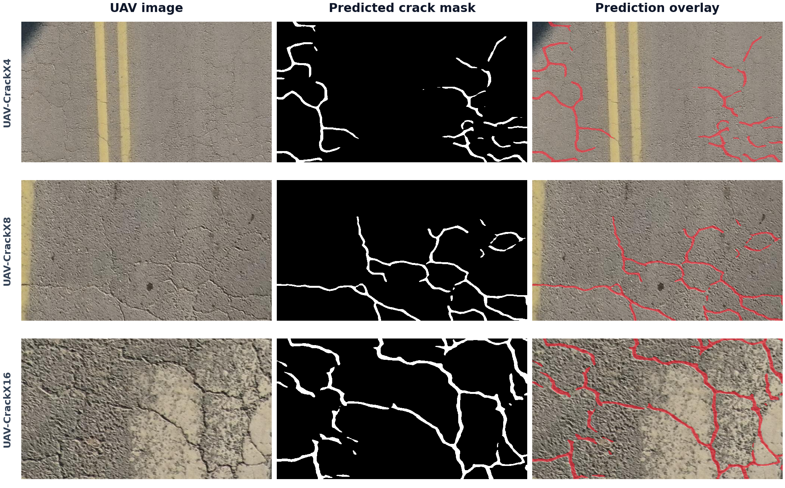

<div align="center">

# 🛰️ UAV Crack Segmentation

### Pixel-Level Road & Pavement Crack Segmentation from UAV Imagery

[](https://www.python.org/)
[](https://pytorch.org/)
[](#-project-overview)
[](LICENSE)
[](http://vlp.chd.edu.cn/tasks/4)

**Thin-crack detection · Native-resolution inference · Topology-aware learning**

</div>


## 🌍 Project Overview

This project turns aerial road images into **pixel-level binary crack maps**, with an emphasis on thin structures, connectivity, and reliable native-resolution prediction. The full submission achieved **82.83% mIoU** on the [UAV-CrackX benchmark leaderboard](http://vlp.chd.edu.cn/tasks/4), ranked #1 seed at the time of submission.

| 🏆 Full seven-model submission | 🎯 Released single-model submission | 🧪 Labeled dataset | 📐 Native resolution |
|:---:|:---:|:---:|:---:|
| **82.83% mIoU** | **81.73% mIoU** | **1,200 pairs** | **672 × 378 px** |

> **Evaluation note:** 82.83% is the official **seven-model ensemble** score, not the score of either individual released checkpoint. The released single-model result is 81.73% mIoU. See [Results and Release Scope](#-results-and-release-scope) and [Model Card](MODEL_CARD.md).

<p align="center">
  
</p>

<p align="center"><sub><i>Conceptual UAV pavement inspection illustration (not an experimental prediction).</i></sub></p>

This compact release provides **MiT-B0 + UPer**, an optional native-resolution RGB/logit refinement head, two trained checkpoints, and complete loading, loss, training, evaluation and flip-TTA code. Replace the example dataset paths to run your own experiments.

### ✨ Highlights

- **🧠 Compact architecture:** MiT-B0 encoder with UPer decoder and optional native-resolution RGB/logit refinement.
- **🕸️ Thin-crack learning:** BCE, soft Dice, and topology-oriented soft clDice supervision.
- **🔎 Reproducible inference:** Two released checkpoints with documented threshold, flip-TTA, and geometry settings.
- **🧪 Practical research baseline:** Dataset manifests, training configurations, tests, and evaluation utilities.
- **📋 Transparent scope:** Distinguishes released components from the full historical ensemble pipeline.

### 🧭 Navigate

[📂 Dataset](#-dataset-uav-crackx) · [🖼️ Predictions](#-prediction-examples) · [📊 Results](#-results-and-release-scope) · [⚙️ Install](#-install) · [🚀 Inference](#-reproduce-a-released-model) · [🗂️ Data](#-data-paths-the-only-required-placeholders) · [🧠 Training](#-train) · [📜 Attribution](#-files-and-attribution)


## 📂 Dataset: UAV-CrackX

[UAV-CrackX](https://github.com/SHAN-JH/UAV-CrackX-Datasets) contains UAV pavement imagery acquired at a 50 m flying altitude with **4x, 8x and 16x magnification**. Thin cracks, textured pavement, shadows and changes in apparent crack width make it a useful benchmark for aerial infrastructure inspection.

| Item | Dataset used in this project |
|---|---|
| Task | Binary semantic segmentation: background/pavement `0`, crack `1` |
| Public labeled data | 1,200 image/mask pairs; 400 per magnification |
| Submission set | 300 images; labels are not public |
| Native image size | 672 x 378 pixels (width x height) |
| Our development split | 1,000 training + 200 capture-group-disjoint validation images |
| Final refit | All 1,200 labeled images, after model selection |

The source dataset and its acquisition procedure are described in [Automation in Construction (2025)](https://doi.org/10.1016/j.autcon.2025.106141) and [IEEE TITS (2024)](https://doi.org/10.1109/TITS.2024.3424525). Download instructions and submission evaluation are available from the [dataset repository](https://github.com/SHAN-JH/UAV-CrackX-Datasets) and [official benchmark](http://vlp.chd.edu.cn/tasks/4).

## 🖼️ Prediction examples

<p align="center">
  
</p>

*Three submission-set examples spanning 4x, 8x and 16x magnification. Left: input RGB. Middle: predicted crack pixels in white. Right: the same prediction overlaid in red. These masks come from the exact **82.83% seven-model submission**, not from a single released model. No test ground truth is displayed or available locally; this figure illustrates predictions rather than per-image accuracy. Mask geometry is unchanged, with no dilation or smoothing.*

## 📊 Results and release scope

| System | Official mIoU (%) | What this repository provides |
|---|---:|---|
| Original MiT-B0 + UPer-128, single model | 81.73 | Full weights and verified inference |
| Refined MiT-B0 member of our best ensemble | Not submitted individually | Full weights and verified component inference |
| Full seven-model submission | **82.83** | Method description and configuration summary; not the entire historical ensemble training pipeline |

> **Important:** **82.83% is the ensemble score, not a single-model result.** The compact trainer is a supervised reference implementation. It does not reconstruct all historical co-training, checkpoint selection and ensemble experiments. Training this example from initialization is not a claim of matching the official scores. See [MODEL_CARD.md](MODEL_CARD.md) for provenance and protocol details.

## ⚙️ Install

Python 3.10+; Python 3.11, PyTorch 2.1.0/cu118 and an RTX 4090 were used for release verification. Install PyTorch for your CUDA version, then:

```bash
python -m pip install -r requirements.txt
python -m pytest tests -q
```

No MMDetection, MMSegmentation, timm, ProMSC checkout or original research folders are needed. The two `.pt` files are included under `checkpoints/`; no additional model download is required for inference. `requirements.txt` gives compatible ranges, not a fully locked environment.

## 🚀 Reproduce a released model

Run from this repository's root. Replace `YOUR_TEST_IMAGES` with a folder of RGB images:

```bash
python predict.py --checkpoint checkpoints/mit_b0_standalone.pt --images YOUR_TEST_IMAGES --output predictions/standalone
python predict.py --checkpoint checkpoints/mit_b0_native_refined.pt --images YOUR_TEST_IMAGES --output predictions/refined
```

The default device is CUDA; add `--device cpu` if needed. CUDA BF16 is used when supported. CPU/other precision, hardware, PyTorch versions and batch sizes can change predictions near the decision threshold. The recorded mask verification applies to the tested environment.

Checkpoint profiles select four-flip TTA, the correct geometry and inference batch size:

| Checkpoint | Threshold | Batch | Geometry |
|---|---:|---:|---|
| `mit_b0_standalone.pt` | 0.51 | 1 | Historical padded-image flips, retained to reproduce the 81.73 submission |
| `mit_b0_native_refined.pt` | 0.50 | 4 | Flip native RGB before padding; crop before inverse flip |

For mixed image dimensions, add `--batch-size 1`. Use `--threshold` to override the profile and `--no-tta` for a quick experiment. The ensemble's 0.44 threshold is **not** a measured optimum for the refined single model.

Outputs are native-size grayscale PNGs with values **0/1**. A prediction report records settings and optional metrics. Original submission basenames are retained: for `foo.JPG_2_z.png`, the output is `foo.JPG_2_z.png`. Duplicate stems require explicit `output_name` fields in a manifest. Prediction reports are not submission masks; zip only PNGs under a `result/` directory if required by the benchmark.

## 🗂️ Data paths: the only required placeholders

Download data separately from the [official task page](http://vlp.chd.edu.cn/tasks/4), subject to its access terms. The README includes only a small qualitative preview; dataset archives, annotations and the full submission predictions are not bundled.

Copy `data/manifest.example.json` to your own manifest and replace every example path. Paths are relative to `--data-root`. Each labeled record has `image`, `mask` and preferably a capture/source `group`; test records need only `image`. An optional `output_name` overrides the PNG basename.

```json
{
  "train": [{"image": "images/train_a.png", "mask": "masks/train_a.png", "group": "capture_a"}],
  "val": [{"image": "images/val_b.png", "mask": "masks/val_b.png", "group": "capture_b"}],
  "test": [{"image": "images/test_c.png", "output_name": "test_c.png"}]
}
```

This short JSON shows the schema; actual training needs batches of at least two. Keep every capture group in one split and provide `group` for all labeled records. The loader rejects overlapping group IDs or identical train/val paths; it cannot infer capture identity or duplicate content for you. The original development setup used 1000 training and 200 source-group-disjoint validation samples. Exact historical split lists are not included in this compact release.

Binary masks must use 0/1 or 0/255. RGB and mask dimensions must match. The loader preserves native resolution (672×378 for this task), jointly flips image/mask/skeleton, applies mild RGB brightness/contrast changes, normalizes with ImageNet RGB statistics and replicate-pads bottom/right to a multiple of 32. Labels and validity maps are zero-padded; padded pixels are excluded from losses and metrics. Skeletons are computed from the original binary mask, before flipping. There is no implicit resizing, feature dropout or strong geometric perturbation.

Evaluate using real labeled masks:

```bash
python predict.py --checkpoint checkpoints/mit_b0_native_refined.pt --manifest YOUR_MANIFEST.json --split val --data-root YOUR_DATA_ROOT --output predictions/validation
```

Metrics pool pixel confusion counts over the split. `mIoU = (IoU_crack + IoU_background)/2`. F1, precision, recall and accuracy are included. Reports use fractions; multiply by 100 for percentage scores. Evaluate a checkpoint only on labels excluded from its training: the released refined checkpoint was refit on all 1200 labels, so those images cannot give an independent validation score.

## 🧠 Train

For a fresh supervised experiment, optionally supply the official ImageNet MiT-B0 encoder weights:

```bash
python train.py --config configs/baseline.json --data-root YOUR_DATA_ROOT --manifest YOUR_MANIFEST.json --output runs/baseline --encoder-weights YOUR_MIT_B0.pth
```

Omitting `--encoder-weights` uses random initialization. Architecture: encoder channels 32/64/160/256, two blocks per stage, first patch stride 2 and a 128-channel UPer decoder. AdamW uses separate encoder/head learning rates, cosine decay with warm-up, gradient accumulation/clipping, EMA and training-only BatchNorm refresh. `history.json` records loss components, images seen, epoch time and validation metrics; `best.pt` selects the best validation mIoU of live/EMA weights. `last.pt` is an inference snapshot, not an optimizer-resume checkpoint.

To add the zero-initialized refinement head to a supervised baseline you trained **on your training split**:

```bash
python train.py --config configs/refined.json --init runs/baseline/best.pt --data-root YOUR_DATA_ROOT --manifest YOUR_MANIFEST.json --output runs/refined
```

The two 24-channel 3×3 convolutions use GELU; GroupNorm follows the first convolution only. A final zero-initialized 1×1 convolution predicts a residual added to the base logits. Encoder, decoder and refiner all remain trainable. `--init` is a warm start, not an exact training resume. Do not initialize an experiment from weights already trained on your validation labels and then claim independent validation.

The supervised loss is:

```text
L = BCE_with_logits + soft_Dice_loss + 0.1 * soft_clDice_loss
```

BCE and Dice are averaged per image over valid pixels. Dice uses additive smoothing 1. Soft skeletonization uses five iterations and bounded [0,1] probabilities; binary ground-truth skeletons supervise centerline coverage. Morphology runs on the unpadded valid rectangle. Partial/nonrectangular annotations are explicitly unsupported for the topology term.

An optional `ensemble_loss` hook implements the final refinement idea: `q = fixed_context + 0.14*sigmoid(student_logits)`, supervised by **real binary labels** using BCE+Dice. Set `ensemble_weight` to 0.5 and provide a native-size `.npy` `fixed_context` for every training record. Each map must be `sum(w_i*p_i)` for the other frozen models, with total weight 0.86. The loader applies the same spatial flips to maps, RGB and masks. Other model outputs are detached. Validation must use teachers that excluded validation labels. Default configs set this term to zero, so ordinary training needs no cached teacher predictions. The minimal trainer selects by single-model validation mIoU; the historical refinement experiment selected by the actual full-ensemble validation mIoU.

After selection, optionally train a fixed short budget on train+val. `configs/refit.json` uses two epochs, encoder/decoder/refinement learning rates 6e-7/3e-6/3e-5, and no ensemble term:

```bash
python train.py --config configs/refit.json --init runs/refined/best.pt --full --data-root YOUR_DATA_ROOT --manifest YOUR_MANIFEST.json --output runs/refit
```

`--full` writes `final.pt`, uses all labeled records and computes no held-out validation score. The test split is never consumed by this supervised reference trainer. Historical ensemble members included transductive co-training using unlabeled submission images; see the model card.

## 📜 Files and attribution

`model.py`, `losses.py`, `dataset.py`, `train.py`, `predict.py` and `utils.py` contain the complete compact implementation.  

Original code is MIT-licensed. **Pretrained-derived checkpoint use is subject to the upstream research/evaluation limitation**; see [WEIGHTS_LICENSE.md](WEIGHTS_LICENSE.md). Architectural and loss references are credited in [THIRD_PARTY_NOTICES.md](THIRD_PARTY_NOTICES.md). No claim is made that MiT, UPerNet, clDice or ProMSC are new contributions of this submission.
